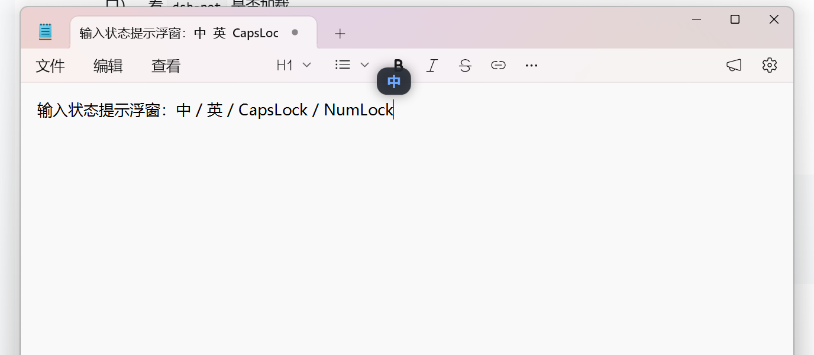

# CaretHUD

在输入光标旁显示当前输入状态的小浮窗——打字前不用低头看任务栏，也知道现在是中文还是英文、大写锁没锁、数字键盘开没开。



## 它会显示什么

| 状态 | 浮窗内容 |
|---|---|
| 中文输入 | 蓝色「中」 |
| 英文输入 | 灰白「英」 |
| CapsLock 开启 | 琥珀色「A」 |
| NumLock 关闭 | 红色小键盘标记 |

浮窗出现在光标正上方、水平居中，跟着光标走；靠近屏幕边缘时会自动移到不会超出屏幕的位置。

## 支持哪些程序

| 程序 | 支持 |
|---|---|
| 记事本、Word、WPS 等日常输入框 | ✅ |
| Chrome、Edge、微信、QQ、VS Code 等 | ✅ |
| 以管理员身份运行的程序 | ❌ 不显示 |
| 全屏游戏 / 视频 | ❌ 不显示 |

## 怎么运行

### 下载即用（推荐）

到 [Releases](https://github.com/Neus117/CaretHUD/releases) 下载最新版 `CaretHUD.exe`，双击运行即可（Windows 10/11，免安装 .NET）。

### 从源码运行

需要 .NET 10 SDK。

1. 从 https://dot.net 下载并安装 .NET 10 SDK（Windows 版）。
2. 在项目目录里执行：

```powershell
dotnet run
```

运行后任务栏托盘会出现程序图标。右键图标：

| 菜单项 | 作用 |
|---|---|
| 说明 | 查看用途与支持范围 |
| 释放内存 | 手动回收内存 |
| 退出 | 关闭程序 |

## 常见问题

**打字时会有一点卡顿吗？**
程序用 Windows 辅助功能接口读取光标位置，已按较低频率查询（光标移动时约 500ms 一次）优先保证输入流畅。若仍影响使用，可在任务管理器结束本程序。

**任务管理器里的内存和程序实际占用不一样？**
任务管理器「内存」列显示的是专用工作集（不含共享的运行库），程序实际工作集更大一些。超过 120MB 会自动回收。

## 已知限制

- 管理员权限窗口、UWP 应用、全屏独占应用不显示。
- 多显示器跨 DPI 未实测。
